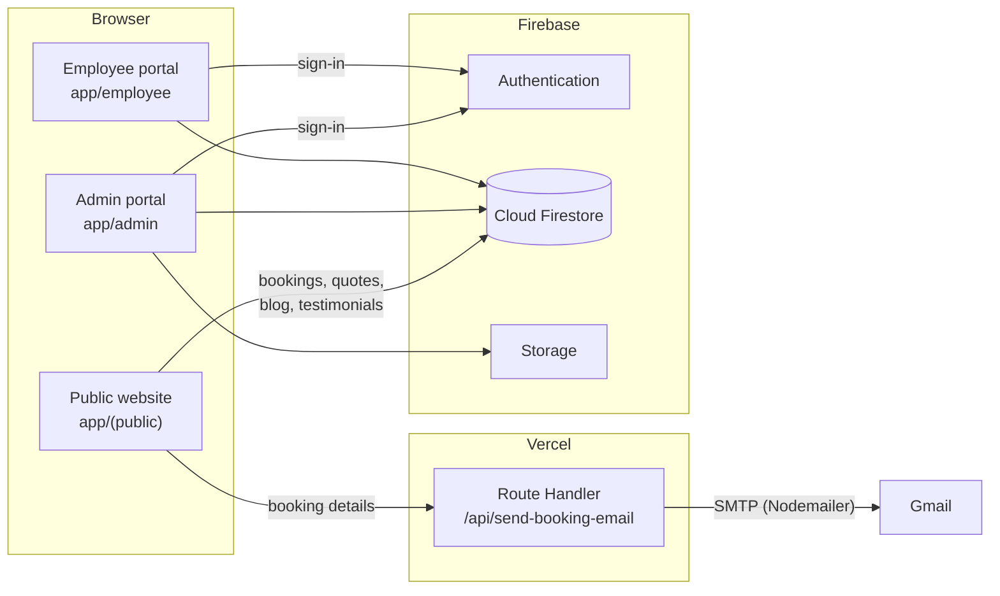

# Silvermaid

Silvermaid is a web platform for Silver Maid, a cleaning and hygiene services company in the UAE. One Next.js application holds two things. The first is the public marketing and booking website. The second is the internal operations portal the team uses to run the business. Before this platform, customer enquiries, quotations, job scheduling, staff records and payroll were all handled separately. Now they live in one Firebase-backed system. A booking made on the website shows up in the admin portal and sends an email notification.

**Live demo:** [silvermaid-cg2i.vercel.app](https://silvermaid-cg2i.vercel.app/)

---

## Contents

- [Features](#features)
- [Technology Stack](#technology-stack)
- [Architecture](#architecture)
- [Repository Structure](#repository-structure)
- [Getting Started](#getting-started)
- [Environment Variables](#environment-variables)
- [Firebase Setup](#firebase-setup)
- [Available Scripts](#available-scripts)
- [Quality Checks](#quality-checks)
- [Deployment](#deployment)
- [Security Notes](#security-notes)
- [Known Limitations](#known-limitations)
- [License](#license)

---

## Features

### Public website (`app/(public)`)

- Marketing pages: home, about, pricing, FAQs, testimonials, careers, contact and privacy policy.
- A catalogue of 25 dedicated service pages, from residential and villa deep cleaning to AC duct, kitchen hood, grease trap, façade and water tank cleaning. A dynamic `services/[slug]` route covers the rest.
- A multi-step **Book a Service** flow. It saves each booking to Firestore and then emails the business through a server-side API route.
- A quotation request page and a blog. Blog posts, testimonials, FAQs and the privacy policy are loaded from Firestore, so editors manage them from the admin portal.
- Contact details (phone and email) come from one shared `ContactContext` that every page uses.

### Admin portal (`app/admin`)

The admin sidebar shows only the modules listed in the signed-in user's `allowedPages`. Modules include:

| Area | What it covers |
| --- | --- |
| Dashboard & reports | Business overview, charts (Recharts) and reports |
| CRM | Leads, clients, sales pipeline and communication history |
| Quotations | Quote builder, approval workflow, history, preview, and PDF export via jsPDF |
| Jobs | Job list, schedule and team assignment, plus per-job checklists: pre-job, equipment readiness, permits, live job view, task progress, damage check, incident log, feedback, review request and closure |
| Job profitability & expenses | Per-job cost and expense tracking |
| HR | Employees, directory, attendance, leave management, payroll and performance |
| Finance | Payments, expenses, and Excel export via SheetJS |
| Bookings & inquiries | Processing website bookings, with real-time notifications from Firestore listeners |
| Meetings | Calendar, notes and decisions, follow-up tracker |
| Products & surveys | Product and category catalogue; site surveys with templates, pricing and results; public survey links at `/survey/[id]` |
| Equipment & permits | Equipment and permit/licence tracking |
| Content | Blog editor, CMS, marketing |
| Employee communication | Employee chat and employee feedback |
| AI Command Center | Rule-based recommendations built from Firestore job data. No external AI service is called. |
| Admin management | User accounts, role manager, permission matrix and audit logs |

### Employee portal (`app/employee`)

Staff sign in to see their dashboard, assigned jobs and tasks, attendance, leave requests, payslips, announcements, profile, requests and chat with the admin team.

### Manager and client views

`app/manager` has dashboard, jobs, meetings, reports and team pages. `app/client/dashboard` and `app/guest/dashboard` give customer-facing overviews. See [Known Limitations](#known-limitations) for how these are reached.

---

## Technology Stack

| Layer | Technologies |
| --- | --- |
| Framework | [Next.js 16](https://nextjs.org/) (App Router), [React 19](https://react.dev/), TypeScript 5 (strict mode) |
| Styling & UI | Tailwind CSS 4, shadcn/ui components built on Radix UI, Lucide icons, Framer Motion, next-themes |
| Forms & validation | React Hook Form, Zod |
| State | React Context (`AuthContext`, `ContactContext`), Zustand (`stores/employeeMessages.store.ts`) |
| Backend services | Firebase Authentication, Cloud Firestore, Firebase Storage, Firebase Analytics |
| Server code | One Next.js Route Handler (`app/api/send-booking-email`) that sends email through Nodemailer over Gmail SMTP |
| Documents & data | jsPDF, jspdf-autotable and html2canvas for PDFs; SheetJS (`xlsx`) for spreadsheets; date-fns |
| Charts | Recharts |
| Tooling | ESLint 9 (`eslint-config-next`), PostCSS, npm |
| Hosting | Vercel |

---

## Architecture

Nearly all of the application runs on the client. Pages are React client components that read and write Cloud Firestore directly through the Firebase Web SDK. Sign-in uses Firebase Authentication. Each user's portal and allowed pages are stored in the Firestore `users-role` collection. The only server-side code is the booking email route. It runs on the server so the SMTP credentials never reach the browser.



**Sign-in flow.** `/login/admin` and `/login/employee` call `validateCredentials` in `lib/auth.ts`. That function authenticates against Firebase Auth and loads the user's record from `users-role`. It checks that the account belongs to the portal being used, then saves a session (name, portal, allowed pages) in `localStorage`. The admin layout uses that session to build the sidebar.

**Main Firestore collections** include `employees`, `clients`, `leads`, `jobs`, `bookings`, `services`, `quotations`, `payroll`, `attendance`, `leave-management`, `products`, `categories`, `surveys`, `meetingCalendar`, `equipment`, `permits_licenses`, `blog-post`, `testimonials` and `users-role`.

---

## Repository Structure

```text
silvermaid/
├── app/
│   ├── (public)/              # Public website: home, services/*, book-service, quote, blog, ...
│   ├── admin/                 # Admin portal: CRM, quotations, jobs, HR, finance, meetings, ...
│   │   └── layout.tsx         # Sidebar, permission-aware navigation, live notifications
│   ├── employee/              # Employee portal
│   ├── manager/               # Manager views
│   ├── client/  guest/        # Customer-facing dashboards
│   ├── login/                 # Portal selection and per-portal sign-in pages
│   ├── survey/[id]/           # Public survey form
│   ├── api/send-booking-email/route.ts   # Server-side booking notification email
│   ├── layout.tsx             # Root layout, fonts, metadata, theme provider
│   └── globals.css
├── components/                # Shared components and shadcn/ui primitives (components/ui)
├── contexts/                  # AuthContext, ContactContext
├── lib/                       # Firebase client, auth helpers, PDF/email helpers, domain types and data
├── stores/                    # Zustand stores
├── public/                    # Static assets (logo, web manifest)
├── .env.example               # Template for required environment variables
├── components.json            # shadcn/ui configuration
├── eslint.config.mjs
├── next.config.ts
├── tailwind.config.ts         # Brand colour palette
├── tsconfig.json
└── vercel.json
```

---

## Getting Started

### Prerequisites

- **Node.js 20.9 or newer.** Next.js 16 requires at least this version. The project was verified on Node 24.
- **npm.** The repository includes a `package-lock.json`.
- A **Firebase project** with Authentication (email/password) and Cloud Firestore enabled. See [Firebase Setup](#firebase-setup).
- A **Gmail account with an App Password**, needed only if you want booking notification emails to send.

### Installation

```bash
git clone https://github.com/faiza-ijaz0/silvermaid.git
cd silvermaid
npm ci
cp .env.example .env.local   # then fill in the values
npm run dev
```

Then open:

- `http://localhost:3000`: public website
- `http://localhost:3000/login`: portal selection
- `http://localhost:3000/login/admin`: admin sign-in, which goes to `/admin/dashboard`
- `http://localhost:3000/login/employee`: employee sign-in

---

## Environment Variables

Copy `.env.example` to `.env.local`. Next.js loads `.env.local` automatically, and it is ignored by Git.

| Variable | Required for | Description |
| --- | --- | --- |
| `GMAIL_USER` | Booking emails | Gmail address that sends the notifications |
| `GMAIL_APP_PASSWORD` | Booking emails | A [Google App Password](https://myaccount.google.com/apppasswords) for `GMAIL_USER`. Never use the account password. |
| `BOOKING_NOTIFICATION_EMAIL` | Booking emails | Inbox that receives a message for each new booking |

These variables are read only on the server (no `NEXT_PUBLIC_` prefix), so they never reach the browser. If any of them is missing, `/api/send-booking-email` returns `500 Email service is not configured`. The booking is still saved to Firestore and the customer still sees the confirmation, because the email step does not block the booking.

---

## Firebase Setup

The Firebase web configuration is in `lib/firebase.ts`. To run against your own project:

1. Create a Firebase project and register a **Web app**.
2. Enable **Authentication → Email/Password**, **Cloud Firestore** and **Storage**.
3. Replace the `firebaseConfig` object in `lib/firebase.ts` with your web app's config.
4. Create your first admin user:
   - Add a user in **Authentication → Users**.
   - In Firestore, create a document in the `users-role` collection. Its document ID must be that user's UID, and it needs these fields:

     ```json
     {
       "email": "admin@example.com",
       "name": "Admin",
       "portal": "admin",
       "allowedPages": ["Dashboard", "CRM", "Quotations", "Jobs", "HR Management", "Finance", "Role Manager"]
     }
     ```

     The values in `allowedPages` must match the keys of `ALL_PAGES_CONFIG` in `app/admin/layout.tsx`. After this first admin exists, you can create more admin and employee accounts from **Admin Management → Role Manager**.
5. Collections are created when data is first written, so you don't need to run any migrations or seed scripts.

---

## Available Scripts

| Command | Description |
| --- | --- |
| `npm run dev` | Start the development server at `http://localhost:3000` |
| `npm run build` | Create an optimised production build (this also runs the TypeScript check) |
| `npm run start` | Serve the production build |
| `npm run lint` | Run ESLint |
| `npx tsc --noEmit` | Run the TypeScript type check on its own |

The project has no automated test suite.

---

## Quality Checks

Checks run on 17 October 2026 with Node 24.18 and npm 11.16:

| Check | Result |
| --- | --- |
| `npm ci` | Passed |
| `npx tsc --noEmit` | Passed, 0 errors |
| `npm run build` | Passed: compiled, type-checked and generated 136 routes |
| `npm run lint` | **Failed**: 840 errors and 1,327 warnings. These were already in the codebase. Most are `@typescript-eslint/no-explicit-any` (547) and `react/no-unescaped-entities` (163). |
| Automated tests | None in the repository |

---

## Deployment

The app is deployed on **Vercel** (`vercel.json` sets the Next.js framework preset).

1. Import the GitHub repository into Vercel.
2. In **Project Settings → Environment Variables**, add `GMAIL_USER`, `GMAIL_APP_PASSWORD` and `BOOKING_NOTIFICATION_EMAIL` for the Production environment, and for Preview too if you need it.
3. Deploy. Vercel runs `npm run build` and serves the output. The booking email route runs as a serverless function.
4. In Firebase, add the Vercel domain under **Authentication → Settings → Authorized domains**.

You can run the app on any other host that supports Next.js 16 with `npm run build && npm run start`.

---

## Security Notes

- **Keep secrets in environment variables.** `.env*` files are ignored by Git, and only `.env.example` (placeholders only) is committed. Never commit `.env.local`.
- **The Firebase web config is not a secret.** The API key in `lib/firebase.ts` only identifies the project to Google and is visible in every browser that loads the app. What actually protects the data is **Firestore and Storage security rules**, together with API-key restrictions in Google Cloud. Those rules are managed in the Firebase console and are not stored in this repository. Make sure they require authentication and check each user's role before allowing writes.
- **Gmail credentials.** Use a dedicated sending account with an App Password and rotate it whenever it might have been exposed. Earlier commits in this repository contained a hard-coded App Password. That credential should be treated as compromised and revoked.
- **Demo credentials.** `lib/auth.ts` (`DEMO_CREDENTIALS`) and the `/debug/auth` page hold example credentials for testing. Make sure no real account uses them, and consider removing the debug page from production builds.

---

## Known Limitations

- **Access control runs in the browser.** Portal sessions are stored in `localStorage`, and the admin layout uses `allowedPages` to choose which navigation items to show. The repository has no server-side middleware for protecting routes. Data security depends on Firestore security rules (see above).
- **Only the admin and employee portals have working sign-in.** The manager, supervisor, client and guest sign-in pages under `app/login/*` are empty placeholders. Two pages, `app/manager/approvals` and `app/manager/clients`, are also placeholders.
- **No automated tests and lint errors remain.** See [Quality Checks](#quality-checks).
- **Some dependencies have open advisories.** At the time of writing, `npm audit --omit=dev` reports advisories for transitive dependencies and for `xlsx` (SheetJS), which has no fix on npm. SheetJS publishes fixed versions on its own CDN.

---

## License

This repository does not include a license file, so all rights are reserved by the author. Please contact the repository owner before reusing the code.

---

## Links

- **Live application:** https://silvermaid-cg2i.vercel.app/
- **Source code:** https://github.com/faiza-ijaz0/silvermaid
- **Author:** [faiza-ijaz0](https://github.com/faiza-ijaz0)
